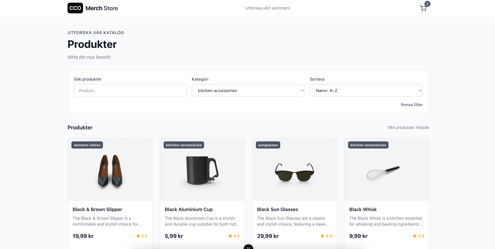
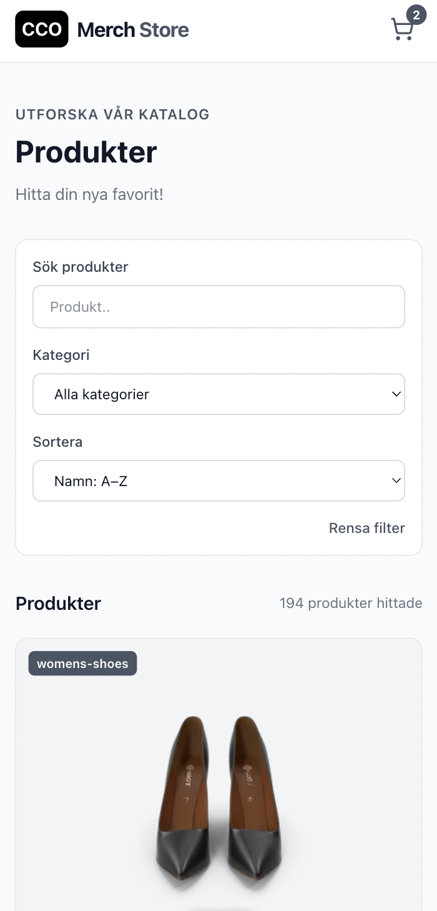

CCO Merch Shop – Mock product shop worktest

A responsive e-commerce demo application built with Vue 3, TypeScript and Tailwind CSS. The application fetches product data from the DummyJSON API and demonstrates common webshop functionality such as product searching, pagination, product details and shopping cart management.

<p align="center">
  
</p>

<p align="center">
  
</p>

Features
Product listing – Fetch and display products from DummyJSON.
API-powered search – Search products directly through the API.
Pagination – Navigate between product pages using server-side pagination.
Product details – Open a modal with additional product information.
Shopping cart – Add, remove and update product quantities.
Cart persistence – Preserve cart contents using localStorage.
Toast notifications – Display feedback when interacting with the cart.
Caching – Cache product listings, search results and individual product details to reduce unnecessary API requests.
Currency formatting – Display product prices in Swedish kronor (SEK).
Responsive design – Optimized for desktop, tablet and mobile devices.
Unit tests – Test important business logic using Vitest.
Tech Stack
Technology Purpose
Vue 3 Frontend framework
TypeScript Type safety
Vite Development server and build tool
Tailwind CSS Styling
Pinia State management
DummyJSON Product API
Vitest Unit testing
Lucide Icons
Getting Started

Follow these instructions to get the application running locally.

Prerequisites

Make sure you have installed:

Node.js (LTS recommended)
npm (included with Node.js)
Git
Installation

Clone the repository:

```bash
git clone https://github.com/ViktorTo/cco-product-store.git
```

### Navigate

```bash
cd cco-product-store
```

### Installation

```bash
npm install
```

### Start development server

```bash
npm run dev
```

### Run tests

```bash
npm run test:run
```

### Build for production

```bash
npm run build
```

Open the local URL provided by Vite, usually:
text
http://localhost:5173

Available Scripts

The following scripts are available in package.json.

Command Description
```
npm run dev Start the development server
npm run build Build the application for production
npm run preview Preview the production build locally
npm run test Run Vitest in watch mode
npm run test:run Run all tests once
npm run test:coverage Run tests and generate a coverage report
Running Tests
```

This project uses Vitest for unit testing.

Run tests in watch mode:
```
bash
npm run test
```

```
Run all tests once:
```

```
bash
npm run test:run
```

Generate a test coverage report:
```
bash
npm run test:coverage
```

### Current Test Coverage

The project includes unit tests for:

Cart Store
Adding products to the cart.
Increasing product quantities.
Calculating cart totals.
Product Cache
Storing and retrieving cached products.
Handling missing cache entries.
Expiring cached products after five minutes.

### API

Product data is provided by DummyJSON.

The application currently uses the following endpoints:

Endpoint Purpose
/products Fetch products
/products/search?q=phone Search products
/products/:id Fetch individual product details

Also parameters sort by and order by

The API supports pagination through the limit and skip query parameters.

No API key is required.

### Project Structure

```
src/
├── assets/ # Global styles and assets
├── components/ # Reusable Vue components
├── composables/ # Reusable composition logic
├── services/ # API requests and caching
├── stores/ # Pinia stores
├── tests/ # Unit tests
├── types/ # TypeScript interfaces and types
├── utils/ # Utility functions
├── views/ # Application views
├── App.vue
└── main.ts
```

### Architecture & Implementation

Composition API: Components and reusable logic are built using Vue 3's Composition API and <script setup lang="ts">.
State management: Pinia manages shared shopping cart state.
Persistence: Cart contents are stored in localStorage and restored when the application starts.
API integration: Product search and pagination are handled by DummyJSON rather than filtering the fetched product list locally.
Caching: An in-memory cache with a five-minute TTL reduces unnecessary API requests.
Request handling: AbortController is used to cancel outdated requests when appropriate.
Testing: Vitest verifies important application logic independently.
Limitations

This is a frontend demo application intended for learning and demonstrating frontend development concepts.

Products and prices are retrieved from DummyJSON.
Cart contents are stored locally in the browser.
There is no backend for user accounts or order management.
Checkout and payment processing are not implemented.
Product stock and prices are not validated by a real commerce backend.
Future Improvements

### Fake error state

In .env.local set:

```
VITE_SIMULATE_API_ERROR=true
```

### Potential features and improvements:

Checkout page and order summary.
Product category filtering.
Improved loading skeletons.
More comprehensive unit tests.
Component tests using Vue Test Utils.
End-to-end tests using Playwright.
Deployment to a hosting platform.
License

This project is intended for educational and portfolio purposes.

Feel free to explore the code and use it as inspiration for your own projects.
